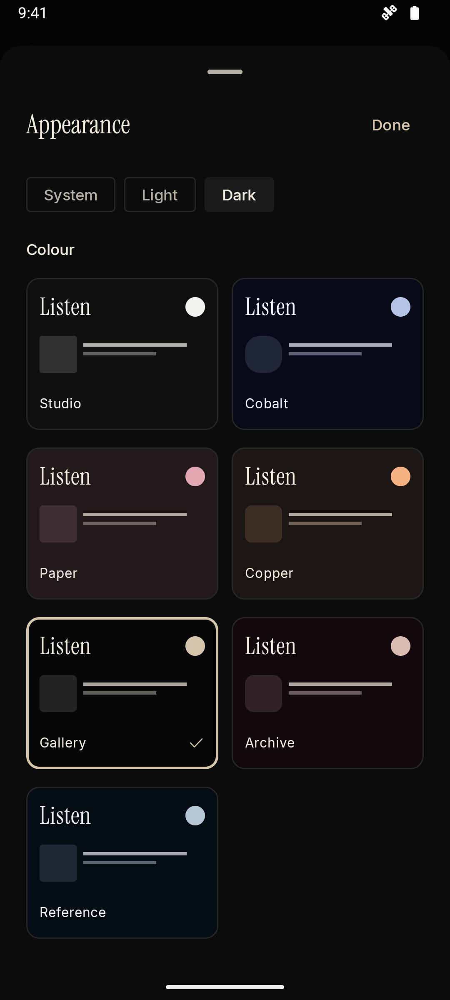

# OpenTune


Android music player for TIDAL and local audio files. Built with Kotlin, Compose, and Media3. Google Play Services are not required.

## Install

[Download OpenTune 0.2.0](https://github.com/yyan115/tidal-app/releases/download/v0.2.0/opentune-0.2.0.apk) for Android 8 or later. The [release page](https://github.com/yyan115/tidal-app/releases/tag/v0.2.0) includes checksums. Allow installation from your browser or file manager when Android asks.

| Listen | Player | Appearance |
| --- | --- | --- |
|  |  |  |

Screenshots are from the signed 0.2.0 app. The player shows a full-length TIDAL FLAC stream at 24-bit/192 kHz.

## Features

- Search TIDAL, browse your collection, and play full tracks with a subscription.
- Play local FLAC, AAC, MP3, and other formats supported by Android.
- Edit and reorder the queue, use shuffle/repeat, and combine local and TIDAL tracks in device playlists.
- Create, rename, and edit your TIDAL playlists. Keep your collection cached and sync saved-track changes after leaving offline mode.
- Download supported audio with Wi-Fi-only controls and play saved copies after signing out.
- Export clear lossless downloads as tagged FLAC files without re-encoding.
- Control playback from notifications, the lock screen, or a Bluetooth device.
- Show the audio format returned by the service rather than assuming the requested quality was delivered.

TIDAL integration is unofficial. It connects directly to TIDAL and requires your own account. Service changes can affect authentication and playback. Protected streams are not supported.

Choose **Sign in to TIDAL**. A secure browser panel opens and returns to OpenTune automatically. See [sign-in](docs/sign-in.md) for details. Lossless modes reject lossy responses instead of silently accepting AAC. New installs default to lossless on both Wi-Fi and mobile data; existing quality preferences are preserved.

## Appearance

Gallery uses deep black, warm accents and Instrument Serif headings. **Settings → Theme** offers seven colour palettes, each with light, dark and system appearance. Choices are saved on the device. Tap the source format in the player to inspect the codec and source resolution.

## Offline files

Choose **Download** in a track's menu or player. Completed downloads appear in **Downloads** and remain playable without an account. Enable **Settings → Offline mode** to use only saved audio.

To keep a standalone file, open a downloaded track's menu and choose **Export audio file**. Pick a destination with Android's file picker. Clear FLAC downloads become tagged `.flac` files without re-encoding; original local files are copied unchanged. Exports stay in the location you choose. Downloads held in app data are removed if you uninstall OpenTune or clear its storage.

## Build

Requirements: JDK 21, Android SDK 36, and Android Build Tools 35.0.0. Set `ANDROID_HOME` or add the SDK path to an untracked `local.properties` file.

```sh
./gradlew :app:assembleDebug
```

The APK is written to `app/build/outputs/apk/debug/app-debug.apk`. Debug and release builds use different application IDs, so both can be installed together.

## Test

```sh
./gradlew :core:test :app:lintDebug
./gradlew :app:connectedDebugAndroidTest
```

The second command needs an emulator or connected Android device. Device tests play an original 24-bit/96 kHz FLAC fixture, exercise the interface, and capture screenshots. Gradle retrieves those images under `app/build/outputs/connected_android_test_additional_output/`.

See [verification](docs/verification.md) for the checks performed and their limits.

## Privacy

Account tokens are encrypted with a key held in Android Keystore. Password entry happens on TIDAL's website. The app has no advertising, analytics, crash-reporting service, or shared account backend. TIDAL still receives account and streaming requests. Local files can be played without signing in.

The file picker grants access only to the audio files you choose. Imported files stay in their original locations. Explicit downloads are stored in app data; temporary streaming cache is limited to 256 MB. Android backup is disabled for account and library data.

## Development

The `core` module contains the service client, models, and stream parsing. The `app` module contains storage, playback, downloads, and the Android interface. Tests do not need a TIDAL password. Keep real accounts, tokens, signing material, and private recordings out of the repository and issue reports.

Read [CONTRIBUTING.md](CONTRIBUTING.md) before submitting a change. Maintainers can follow the [release guide](docs/releasing.md). Report vulnerabilities using [SECURITY.md](SECURITY.md).

## License

[GPL-3.0-or-later](LICENSE). Dependency licences are listed in [THIRD_PARTY_NOTICES.md](THIRD_PARTY_NOTICES.md).
