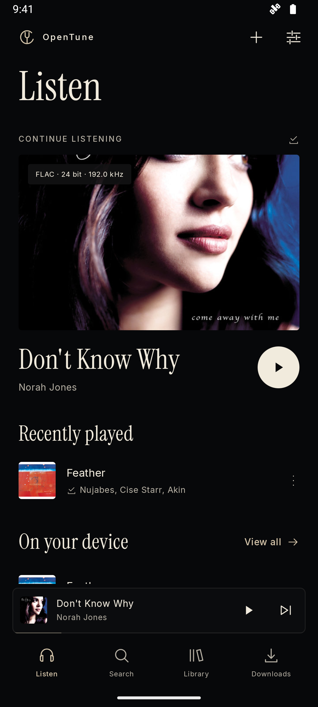
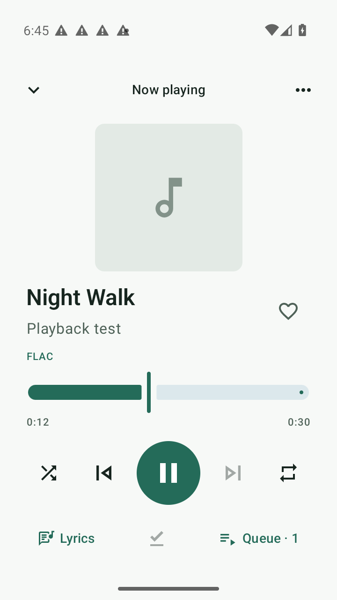
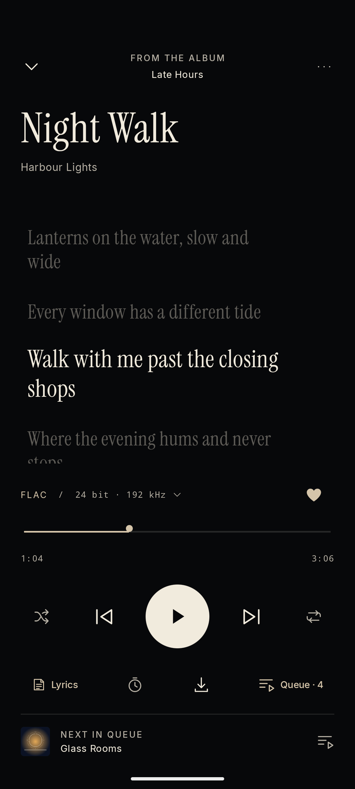

# OpenTune


Unofficial open source Android music player for TIDAL.

OpenTune plays your TIDAL library in lossless quality, along with your own audio files. It has no ads, analytics or tracking, and it connects only to TIDAL.

[](https://github.com/yyan115/tidal-app/actions/workflows/check.yml)
[](https://github.com/yyan115/tidal-app/releases)
[](LICENSE)

<p align="center">
  
  &nbsp;
  
  &nbsp;
  
</p>

## Install

Download the APK from the [newest release](https://github.com/yyan115/tidal-app/releases) and open it. Releases before 1.0.0 are marked as prereleases. OpenTune needs Android 8 or later. Android may ask you to allow installs from your browser or file manager.

To receive updates automatically, add `https://github.com/yyan115/tidal-app` to [Obtainium](https://obtainium.imranr.dev/) and turn on **Include prereleases**.

Releases are signed with one certificate. Compare it with the fingerprint below before you install, for example with [AppVerifier](https://github.com/soupslurpr/AppVerifier).

```text
SHA-256  4C:75:C0:15:05:B6:F2:A3:CF:88:57:6E:D4:A6:DA:93:AF:BD:13:D1:17:CF:7A:3A:C3:41:0C:AB:B9:66:B6:24
```

Each release also includes a `SHA256SUMS` file and a build provenance attestation. To check the attestation:

```sh
gh attestation verify opentune-<version>.apk --repo yyan115/tidal-app
```

## Features

- Stream TIDAL in lossless FLAC, up to 24-bit/192 kHz where TIDAL provides it. Lossless settings never fall back to AAC.
- Follow the lyrics as the song plays. The current line is highlighted and a tap on a line seeks to it.
- Find music from your TIDAL mixes, radio stations, new releases, genres and moods, and open artist and album pages with biographies, reviews and credits.
- Search the catalogue and browse your saved tracks, albums, artists and playlists. Create and edit TIDAL playlists.
- See the codec, bit depth and sample rate of the playing track.
- Download tracks and play them without a connection or an account.
- Play local audio files and combine them with TIDAL tracks in playlists.
- Edit the queue, shuffle and repeat. Control playback from the notification, the lock screen or a Bluetooth device.
- Use offline mode and Wi-Fi-only downloads, and optionally keep your saved tracks downloaded.
- Set a sleep timer, normalize volume, use an equalizer and watch music videos.
- Browse your library from a car or a Bluetooth device, ask a voice assistant to play music, and control playback from a home screen widget.
- See your own listening statistics, back up your device data and optionally scrobble to ListenBrainz.
- Export downloads and local files to a folder you choose.

The [usage guide](docs/usage.md) covers signing in, audio quality, downloads and export.

## Privacy

OpenTune connects to TIDAL. It has no ads, analytics, crash reporting or server of its own. The only other connection is scrobbling, which is off by default. If you turn it on and add a token, OpenTune sends the artist, title and album of tracks you finish to the ListenBrainz server that you choose.

- You sign in on TIDAL's website in your browser. OpenTune never receives your password.
- Account tokens are stored encrypted with a key held in the Android Keystore.
- OpenTune requests no storage, location, contacts or microphone permissions. It reads only the files you pick with the system file picker.
- Android backup and device transfer exclude OpenTune data.

TIDAL still receives your account and streaming requests.

## Disclaimer

OpenTune is an independent project. It is not affiliated with, endorsed by or sponsored by TIDAL. TIDAL is a trademark of its owner.

Streaming requires a TIDAL subscription. OpenTune uses TIDAL's unofficial interfaces, so TIDAL can change or block them without notice. Protected streams are not supported. You are responsible for following TIDAL's terms of service.

## Build

You need JDK 21, Android SDK 36 and Android build tools 35.0.0. Set `ANDROID_HOME` or put the SDK path in an untracked `local.properties` file.

```sh
./gradlew :app:assembleDebug
```

The APK is written to `app/build/outputs/apk/debug/app-debug.apk`. Debug and release builds use different application IDs, so both can be installed together.

## Contributing

Read [CONTRIBUTING.md](CONTRIBUTING.md) before you open a pull request. Report security problems as described in [SECURITY.md](SECURITY.md). Maintainers can find the release process in [docs/releasing.md](docs/releasing.md).

## License

[GPL-3.0-or-later](LICENSE). Dependency licenses are listed in [THIRD_PARTY_NOTICES.md](THIRD_PARTY_NOTICES.md).
